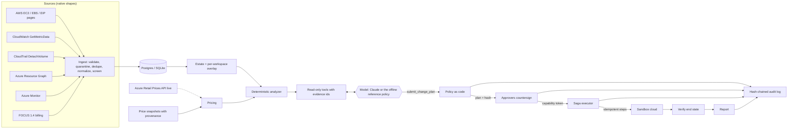
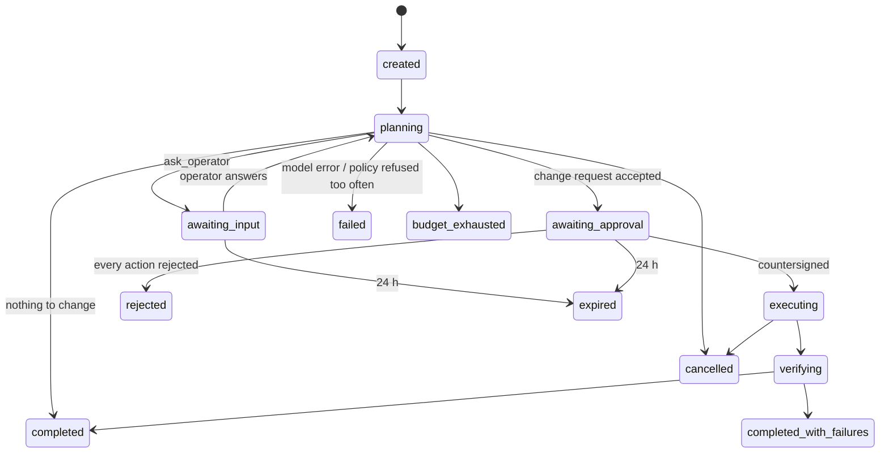

# Architecture

Countersign is a cloud-cost agent built around one rule: **the model proposes, deterministic code disposes.**
The model can read the estate and submit a change request. It cannot change anything. Changes happen only in
the runtime, after people countersign, through an executor that needs a capability token minted by that
decision and verified again at the cloud boundary.

## Packages (`backend/countersign/`)

| Package | Responsibility |
|---|---|
| `data/` | Source adapters in each provider's native shape (paginated `DescribeInstances`, Resource Graph rows, `GetMetricData`, FOCUS 1.4 CSV), normalization to one model, quality checks (schema, completeness, uniqueness, freshness, reconciliation), quarantine, live and snapshot pricing, the estate cache and per-workspace overlay |
| `domain/` | Pure rules: resources, the analyzer (idle, oversized, unattached, unused, conflicts) with blockers and warnings, the 730-hour month, nearest-rank percentiles, protection tags |
| `security/` | Secret redaction and prompt-injection screening at ingest |
| `tools/` | The registry (schema validation, timeouts, result-size bounds) and nine tools: seven read tools plus the two control tools the runtime handles (`submit_change_plan`, `ask_operator`) |
| `models/` | The `ChatModel` protocol in Anthropic Messages semantics, the Claude adapter, the offline reference policy |
| `policy/` | `policy.yaml` (P-001 to P-008), risk, approval routing; evaluated at submission, at decision and through the token |
| `agent/` | The durable run state machine, budgets, retries with full jitter, the circuit breaker, fault injection, the system prompt |
| `execution/` | HMAC capability tokens, the saga executor with compensation, the sandbox cloud with idempotency keys |
| `audit/` | A hash chain per workspace and its verifier |
| `observability/` | OpenTelemetry GenAI spans (`invoke_agent`, `chat`, `execute_tool`) exported into the run's history |
| `auth/` | Demo personas, JWTs checked against the service clock, roles |
| `api/` | FastAPI, RFC 9457 problem+json, rate limits, security headers, the cron sync |
| `evals/` | Dataset, graders, mutants, runner, statistics, fingerprint, reports (see `docs/evaluation.md`) |

Five import-linter contracts keep this layering honest and run in CI: the domain imports nothing else, the policy
depends on the domain only, only the runtime imports the executor, the model layer reaches no store, tool or
executor even indirectly, and nothing below the API depends on the API or the evaluation.

## The run, a durable state machine

- **One unit of work per tick.** `POST /api/runs/{id}/advance` does one model turn, or one action's execution,
  or the verification. The state, its events, spans and audit entries are saved in one transaction.
- **A lease before any model call.** A compare-and-set on `lease_owner` and `lease_until` admits one worker per
  run; a second gets 409. A worker that dies holding a lease loses it after 120 s.
- **Effectively-once effects.** Every step's idempotency key is `sha256(run | plan hash | action | step)`. The
  sandbox commits its write separately from the run state, so a crash between the two replays the step instead
  of repeating it.
- **Partial failure.** Compensation happens only inside an action's own chain, in reverse (a resize that fails
  after the VM was stopped starts the VM again); independent actions are not rolled back; irreversible steps (delete,
  release) run last; a run with some failed actions ends `completed_with_failures`.
- **Ticks are driven, not autonomous.** The UI and the tests advance runs. Production would put the same tick
  behind a queue or a workflow engine; the state machine does not change.

## The model boundary

The model sees seven read tools: `get_estate_summary`, `find_waste`, `get_resource`, `get_utilization`,
`get_cost_history`, `quote_price`, `check_policy`, and two control tools the runtime handles itself:
`submit_change_plan` and `ask_operator`. Every read tool returns an evidence id; an action must cite evidence
this run retrieved about its own resource (P-004). Only `ref`, `operation`, `target_sku`, `rationale` and
`evidence_ids` come from the model; every number in a plan (costs, savings, risk, steps) is computed by code
from the analyzer's finding. A change request also lists what the agent reviewed and left out, with reasons, so
an approver sees the exclusions next to the proposals.

`ChatModel` speaks the Anthropic Messages format (text and `tool_use` blocks, `stop_reason`, usage). Two
implementations:

- **`ClaudeModel`** (official `anthropic` SDK): strict tool schemas, adaptive thinking, prompt caching, SDK
  retries off (the runtime owns retries and the circuit breaker), errors mapped to retryable or fatal kinds,
  the key never logged. Used when `ANTHROPIC_API_KEY` is set.
- **`ReferencePolicy`**: a deterministic double that reads the conversation the way a model would and works
  through the same tools under the same policy. It is the default, so the public demo never spends tokens.

## Data

The fixture estate is 149 resources in two AWS accounts and two Azure subscriptions, with 31 days of daily CPU
and an October FOCUS 1.4 billing export, generated with a fixed seed and documented scenario by scenario in
`backend/fixtures/README.md` (idle, oversized, unattached, unused, production, protected, injection, secret,
conflict, too new, gappy, grace period) plus planted data defects that ingestion must catch. AWS prices come
from the official Price List file (offer version and SHA-256 recorded); Azure prices from the public Retail
Prices API, live with a committed snapshot as fallback. Monthly figures use the 730-hour convention.

## Deployment

One Vercel project with two services from `vercel.json`: `web` (the Vite build) and `api` (FastAPI, Python
3.14). One origin, so no CORS. Neon Postgres (free plan) holds the state; a daily cron calls `/api/cron/sync`
(re-ingest, purge expired workspaces) with a bearer secret. Production refuses to start with development
secrets. The live demo runs keyless.
